<!-- Ganti semua "USERNAME" dengan username GitHub kamu, dan "Nama Kamu" dengan namamu -->

<!-- ===== HEADER ANIMASI (gelombang bergerak, file lokal) ===== -->

  

<!-- ===== TEKS MENGETIK ===== -->

  

  
  
  

## ✨ Tentang Saya

Saya percaya bahwa produk digital terbaik lahir dari pertemuan **kode yang rapi** dan **desain yang bermakna**.

- 💻 Sebagai **Front-End Developer**, saya membangun website yang cepat, responsif, dan nyaman digunakan.
- 🎨 Sebagai **Graphic Designer**, saya mengolah ide menjadi visual yang kuat, mulai dari identitas, poster, hingga UI.
- 🌱 Sedang terus belajar dan mengeksplorasi hal baru di dunia web & desain.
- 🤝 Terbuka untuk kolaborasi, proyek komunitas, dan diskusi seputar desain dan pengembangan web.

## 🛠️ Tech Stack

<h3 align="center">💻 Front-End</h3>

  

<h3 align="center">🎨 Design Tools</h3>

  

## 🚀 Proyek Pilihan

| Proyek | Deskripsi | Teknologi |
| :----- | :-------- | :-------- |
| 🔗 **[Nama Proyek 1](https://github.com/USERNAME/repo-1)** | Deskripsi singkat proyek dalam satu kalimat. | `React` `Tailwind` |
| 🔗 **[Nama Proyek 2](https://github.com/USERNAME/repo-2)** | Deskripsi singkat proyek dalam satu kalimat. | `HTML` `CSS` `JS` |
| 🔗 **[Nama Proyek 3](https://github.com/USERNAME/repo-3)** | Deskripsi singkat proyek dalam satu kalimat. | `Next.js` `TypeScript` |

## 🎨 Portofolio Desain

  
  
  

## 📊 GitHub Stats

  
  

  

  

### 📈 Grafik Aktivitas

  

### 🐍 Ular Pemakan Kontribusi

  <picture>
    <source media="(prefers-color-scheme: dark)" srcset="https://raw.githubusercontent.com/ujiphoria/ujiphoria/output/github-snake-dark.svg" />
    <source media="(prefers-color-scheme: light)" srcset="https://raw.githubusercontent.com/ujiphoria/ujiphoria/output/github-snake.svg" />
    
  </picture>

## 📫 Mari Terhubung

  
  
  

  

<!-- ===== FOOTER ANIMASI ===== -->

  

